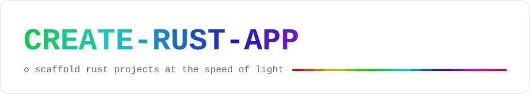

<div align="center">

<picture>
  <source media="(prefers-color-scheme: dark)" srcset="assets/brand/banner-dark.svg">
  
</picture>

**Scaffold Rust projects (CLI, GUI, TUI, library or workspace) with strict lints, real CI, signed
releases, and a house style that checks itself.**

[](https://github.com/freeknet/create-rust-app/actions/workflows/ci.yml)


<sub>In a truecolor terminal the banner animates: every letter takes its own hue and the rule sweeps the spectrum for about a second, then settles. <code>NO_COLOR</code>, pipes and CI get plain text.</sub>

</div>

---

## Quick start

```bash
npx create-rust-app            # interactive
npm create rust-app            # same thing, npm-init style

npx create-rust-app my-tool --preset cli -y     # no questions asked
npx create-rust-app my-gui --preset rustaman --with tray,singleInstance
npx create-rust-app --preset lib --dry-run --json  # see the plan, write nothing
```

Then:

```bash
cd my-tool
cargo run
cargo test
cargo clippy --all-targets --all-features -- -D warnings
```

Interactively it's three screens: a name, what you're building, and a review of everything that
will be generated in plain words. From the review you **Create it**, or **Customize…** any section
(crates, app features, tooling, licence and Rust version, post-steps) and come back to it. The
finish screen prints the next commands and the one-line command that recreates the project
without prompts.

Needs Node 22.18+. Rust is optional at scaffold time; when `cargo` is on `PATH` the new project gets
a `cargo fetch` (and, with `--cargo-check`, a full `cargo check`), and you get a
`rustup toolchain install` hint if the pinned channel is missing.

## Presets

| Preset | What you get | Kind | Edition | Licence |
|---|---|---|---|---|
| `rustaman` | single-crate desktop GUI (Windows-first, builds on Linux) · eframe + wgpu · winres icon/manifest · screenshot example | `gui` | 2021 | MIT |
| `strobe` | cargo workspace desktop app · winit + glutin + egui_glow · `cargo xtask ci` / `changelog` | `workspace` | 2024 | MIT + Commons Clause |
| `cli` | clap + anyhow + env_logger, full tooling | `cli` | 2024 | MIT |
| `tui` | ratatui + crossterm terminal app | `tui` | 2024 | MIT |
| `lib` | publishable crate · thiserror · docs.rs ready, no binary | `lib` | 2024 | MIT OR Apache-2.0 |
| `minimal` | Cargo.toml + lints + main + CI, nothing else | `cli` | 2024 | MIT |

With no preset you get the defaults: a single-crate eframe GUI, edition 2024, MSRV 1.98,
toolchain pinned to 1.99.1, every tooling option on. Presets are just partial answers layered on
those defaults (see [`src/presets.ts`](src/presets.ts)); any flag below overrides them.

## Flags

```text
create-rust-app [dir] [options]
```

| Flag | Meaning |
|---|---|
| `[dir]` | Target directory (defaults to the project name) |
| `--name <kebab>` | Crate / project name, `^[a-z][a-z0-9-]*$` |
| `--preset <p>` | `rustaman` `strobe` `cli` `tui` `lib` `minimal` |
| `--kind <k>` | `cli` `gui` `tui` `lib` `workspace` |
| `--gui <stack>` | `eframe` (wgpu) or `winit-glow` (winit + glutin + egui_glow) |
| `--edition <e>` | `2024` or `2021` |
| `--msrv <v>` | `rust-version` in Cargo.toml (default `1.98`) |
| `--toolchain <v>` | Exact channel pinned in `rust-toolchain.toml` and CI (default `1.99.1`) |
| `--license <l>` | `MIT`, `MIT+CommonsClause`, `Apache-2.0`, `MIT OR Apache-2.0` |
| `--author <name>` | Author for Cargo.toml, LICENSE, headers |
| `--github <user>` | GitHub handle for CODEOWNERS and repository links |
| `--accent <#hex>` | Accent colour for GUI themes (default `#00e5ff`) |
| `--with a,b` | Turn on features / tooling, e.g. `--with tray,commandPalette` |
| `--without a,b` | Turn them off, e.g. `--without release,dependabot` |
| `-y`, `--yes` | Accept defaults for anything not given; no prompts |
| `--no-git` | Skip `git init -b main` and the initial commit |
| `--no-fetch` | Skip `cargo fetch` after writing (on by default: seconds, not minutes) |
| `--cargo-check` | Also run `cargo check --all-targets` (off by default; a GUI project compiles eframe/wgpu) |
| `--no-cargo-check` | Skip `cargo check` even if a preset turns it on |
| `--open <editor>` | Open the project in `code` or `cursor` when done |
| `--dry-run` | Print the plan, write nothing |
| `--json` | Machine-readable output |
| `--no-color` | Plain output (also honoured: `NO_COLOR`, non-TTY, `CI`) |
| `--quiet` | Only errors |
| `--force` | Write into a non-empty directory |
| `--help`, `--version` | The usual |

A non-TTY stdin implies `--yes`.

## What you get

### Lints that mean it

Every project carries the same lint block (single crates in `[lints]`, workspaces in
`[workspace.lints]` with `[lints] workspace = true` per crate):

| `[lints.rust]` | level | `[lints.clippy]` | level |
|---|---|---|---|
| `warnings` | deny | `unwrap_used` | deny |
| `dead_code` | deny | `expect_used` | deny |
| `missing_docs` | deny | `panic` | deny |
| `unreachable_pub` | **forbid** | `todo` / `unimplemented` / `unreachable` | deny |
| `unused_imports` | **forbid** | `wildcard_enum_match_arm` | deny |
| `unused_must_use` | **forbid** | `match_wildcard_for_single_variants` | deny |
| `unreachable_patterns` | **forbid** | `allow_attributes` | deny |
| `unsafe_op_in_unsafe_fn` | deny | `undocumented_unsafe_blocks` | deny |
| `non_snake_case` & friends | deny | `missing_safety_doc` | deny |

One deliberate exception: projects that log with `tracing` get `unused_imports = "deny"` instead of
`forbid`, because tracing's event macros expand to `#[allow(unused_imports)]`, which `forbid` turns
into a hard error (E0453).

Exceptions are written `#[expect(lint, reason = "…")]`, never `#[allow]`. Tests return
`anyhow::Result<()>` and every `assert!` carries a message. Release profile: LTO, one codegen
unit, `panic = "abort"`, plus a `release-fast` profile for quick optimised builds.

### Header banners

Every `.rs` file opens with the same banner, and the `Module:` line is derived from the path:

```rust
// ============================================================================
// Module:       gui::ui::theme
// Description:  Palette and egui visuals derived from the active theme.
//
// Dependencies: egui
// ============================================================================

//! Theme bindings for egui.
```

`src/lib.rs` → `my_app (library crate root)`, `src/main.rs` → `my_app (binary crate root)`,
`tests/x.rs` → `x (integration test)`, and workspace crates get their crate as a prefix
(`crates/neon-app/src/cli.rs` → `neon_app::cli`). A generated `src/header_check.rs` test walks the crate and fails the build
when a banner drifts.

### An `unsafe` boundary

GUI projects keep FFI in `src/win/` (and the GL loader in `src/gui/run/` for the winit + glow
runtime) only, one call per private safe function, a `// SAFETY:`
comment on each, and `Drop` types that own every handle. `src/unsafe_check.rs` enforces it.

### A pinned toolchain

`rust-toolchain.toml` pins an exact channel with `clippy` + `rustfmt`. `tests/toolchain_pin.rs`
checks that every workflow's `toolchain: "…"` matches it, so CI and your laptop never disagree.

### CI and releases with attestations

- `ci.yml`: format, cargo-deny, Windows (clippy `-D warnings`, test, release build) and Linux
  jobs; concurrency-cancelled, `contents: read`, a timeout on every job, every action pinned to a
  full commit SHA.
- `release.yml`: push a `v*` tag → draft release → build and zip per target → CycloneDX SBOM +
  SHA-256 → build-provenance and SBOM attestations → publish. A tag-vs-Cargo.toml check runs first.
- Dependabot (cargo + github-actions, weekly, grouped), CODEOWNERS, issue forms, PR template,
  SECURITY.md, and agent docs (`AGENTS.md`, `CLAUDE.md`) if you want them.

### cargo-deny

`deny.toml` with an explicit licence allow-list, `unknown-registry` / `unknown-git` denied,
yanked crates warned, and duplicate versions surfaced.

## How templates work

Templates live in `templates/<group>/files/**`. Groups apply in order and later ones win on the
same path, so a feature group can replace a base file. Inside any text file:

```rust
// @if gui_eframe & !tray
use eframe::egui;
// @end
pub const NAME: &str = "@@displayName@@";
```

- `@@token@@` is substituted (unknown tokens throw, so typos fail tests loudly).
- `@if` / `@elif` / `@else` / `@end` lines after any comment leader are evaluated against the
  context flags and removed.
- `_gitignore` becomes `.gitignore`, `.tmpl` is stripped, binaries are copied raw.
- Cargo.toml and deny.toml are composed in JavaScript (`src/gen/`), and groups declare crates
  through `templates/<group>/deps.js` instead of editing Cargo.toml.

The full rules (Ctx shape, flags, tokens, manifests, the GUI runtime seam) are in
[docs/CONTRACTS.md](docs/CONTRACTS.md); the design is in [docs/PLAN.md](docs/PLAN.md).

## Contributing

```bash
npm ci
npm run typecheck                                 # tsc, strict
npm test                                          # node --test, straight from the .ts sources
npm run build                                     # dist/, what npm publishes
node scripts/scaffold-check.mjs <preset>          # scaffold + fmt + clippy -D warnings + test
node scripts/scaffold-check.mjs <preset> --gate check   # cargo check only, faster
node scripts/scaffold-check.mjs cli --set crates.async=tokio --set crates.http=reqwest
```

Strict TypeScript with only two runtime dependencies (`@clack/prompts`, `picocolors`). Node runs
the `.ts` sources directly during development, but it won't strip types inside `node_modules`,
which is where `npx` runs from, so the package ships compiled JS from `dist/`. Shared shapes
(`Answers`, `Ctx`, `Dep`, `PlanEntry`) live in `src/types.ts`.

Every preset must come out passing `cargo fmt --check`,
`cargo clippy --all-targets --all-features -- -D warnings` and `cargo test`. Commits use
conventional prefixes (`feat:`, `fix:`, `docs:`, `test:`, `build:`, `ci:` …), and notable changes
go under `## [Unreleased]` in [CHANGELOG.md](CHANGELOG.md).

## Branding


Everything in [`assets/brand/`](assets/brand) is generated by `node scripts/brand.mjs` from the same
hue math as the terminal banner, so the README, the social card and the CLI always agree:

| File | Use |
|---|---|
| `banner-dark.svg` / `banner-light.svg` | README header (`<picture>` picks by colour scheme) |
| `mark.svg` / `mark-transparent.svg` | the prism mark: six facets in the prompt-bullet colours and a `>` |
| `social-preview.svg` / `.png` | 1280×640 card for *Settings → Social preview* on GitHub |

Palette: prompt stops `#ff6ec7` `#ff9f6e` `#ffd36e` `#b6ff6e` `#7cf7ff` `#8a5cff` on `#0c0b12`.
Wordmark hue runs 140° → 266° (green → cyan → violet), with each letter 9° on from the last.

## How this repo is built

The work is split into tasks in [`tools/swarm/tasks/`](tools/swarm/tasks), each owning a
disjoint set of paths and declaring a gate command. `node tools/swarm/swarm.mjs run` fans them out to
headless Codex workers, one git worktree and branch per task, and merges green work into
`swarm/integration` for a human to review:

- **Budget first.** Before launching, it reads the ChatGPT plan's usage windows through
  `codex app-server` (`account/rateLimits/read`, which spends nothing). It refuses to start above
  `--max-used` and stops launching workers while throttled. `swarm quota` prints the windows.
- **Model per task.** The default is the workhorse tier (`gpt-6.1-sol`, medium effort). Tasks opt
  into `gpt-6-luna` for docs, `gpt-6.1-terra` for mechanical work, or higher effort, through
  frontmatter. Workers never inherit the frontier model from `~/.codex/config.toml`.
- **Cache-friendly prompts.** Every worker gets the same preamble first, so the prompt cache serves
  it to workers 2..N, and the task-specific part comes after.
- **Trust, then verify.** Workers can't commit (`.git` is read-only to them). The orchestrator
  checks that the diff stays inside the task's `owns` globs and runs the gate outside the sandbox.
  If the gate fails, it resumes the worker's own thread, cheaply from cache, with the log tail, up
  to `--repairs` times.
- **Structured hand-back.** Each worker ends with a JSON report
  (`tools/swarm/report.schema.json`): status, files, checks run, unfinished items, and proposed
  contract changes.

Workers code against [docs/CONTRACTS.md](docs/CONTRACTS.md), which is what keeps them from stepping
on each other. `swarm prepare <id>` and `swarm finish <id>` let any other agent, or a person, work a
task through the same ownership check, gate and merge.

## License

[MIT](LICENSE) © 2026 Lawrence Norton
